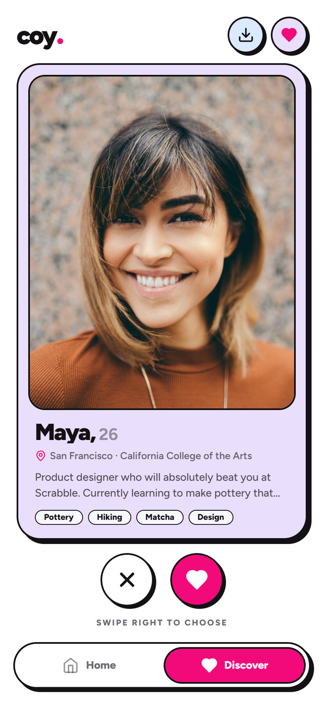
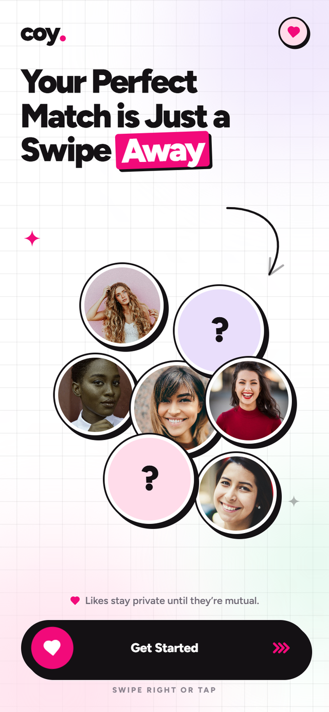
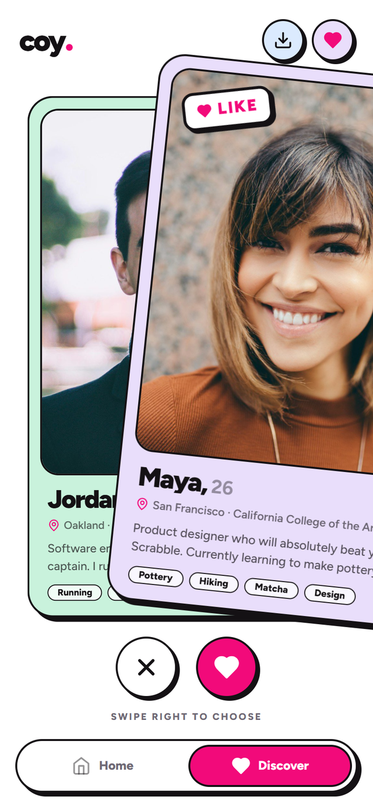
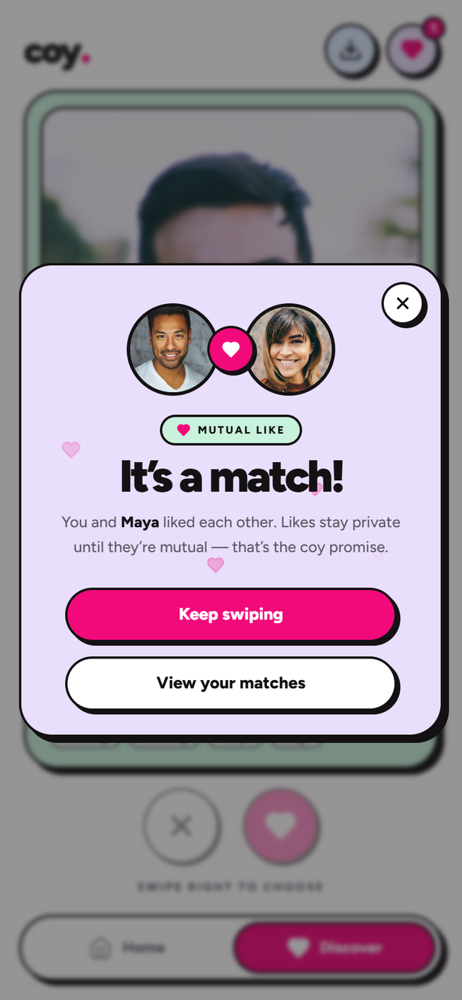
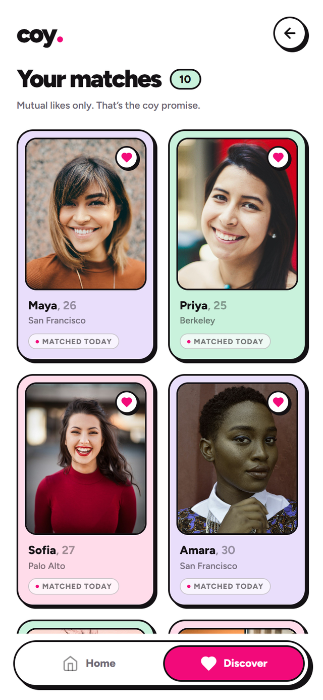
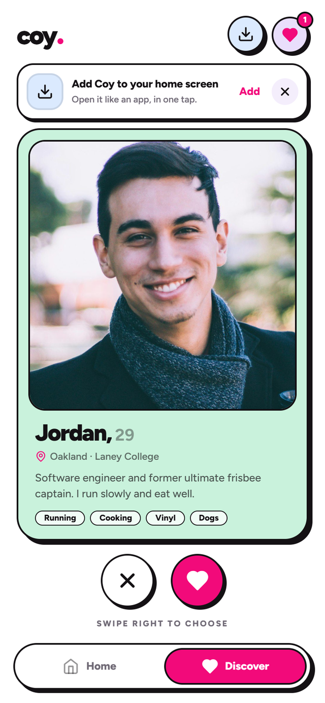
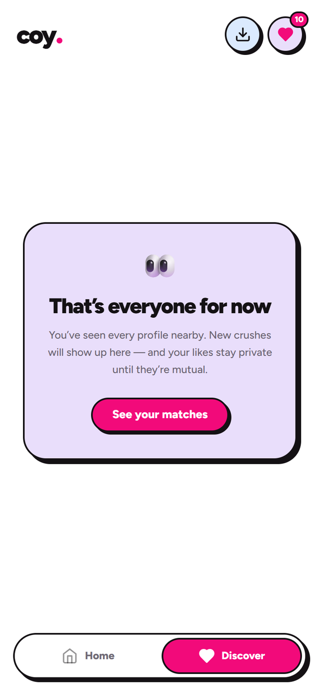
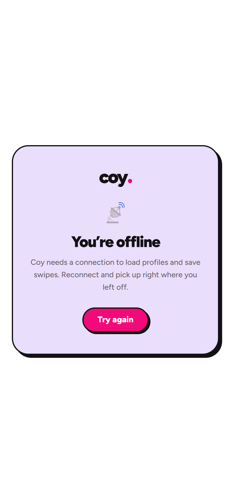

# coy. — Discover

A mobile-first, swipe-to-match experience built with **Next.js 16, React 19, TypeScript, and
Tailwind CSS v4**. It is a complete, installable PWA with an onboarding screen, a draggable card
deck, mutual-only matches, an offline shell, and a small JSON-backed API.

<p align="center">
  
</p>

> **The Coy promise:** the app never reveals who already liked you. A match is only announced at
> the exact moment a like becomes mutual.

<p>
  
  
  
  
  
</p>

## What's inside

| Area | What it does |
| ---- | ------------ |
| **Onboarding** | A first-visit intro with a match constellation, a privacy reminder, and a “Get Started” control you can tap, press, or swipe right. Completion is remembered in `localStorage`. |
| **Discover** | One card at a time with a pointer-driven drag, LIKE/NOPE stamps, a spring-back, fly-out ghosts, Pass/Like buttons, and `←`/`→` keyboard support. |
| **Matching** | A match requires a mutual like. The “It’s a match!” dialog appears immediately and lists the person in Matches. |
| **Matches** | Mutual matches only, newest first, with relative timestamps and an empty state. |
| **Privacy** | `likedYou` is stripped from every API response. One-sided likes never reach the client. |
| **No repeats** | Every swipe is persisted; `GET /feed` filters out anyone already swiped. |
| **PWA install** | Web app manifest, maskable icons, and an in-app install banner. Uses the native Chromium prompt and clear iOS/Safari/Firefox guidance. Hidden when already installed. |
| **Offline shell** | A versioned service worker caches the app shell, photos, and icons, and never caches the API. Discover detects an offline feed and retries automatically when the connection returns. |
| **Persistence** | Swipes and matches live in `data/store.json` with serialized, atomic writes that survive reloads and restarts. |
| **Accessibility** | Labelled controls, focus-managed dialog, keyboard swiping, `aria-live` feedback, and `prefers-reduced-motion` support. |

## Screenshots

Captured from the production build in a 390 × 844 mobile viewport.

<table>
  <tr>
    <td align="center" width="33%">
      
      <br /><sub><b>First visit</b> — one swipe to begin</sub>
    </td>
    <td align="center" width="33%">
      
      <br /><sub><b>Drag feedback</b> — LIKE / NOPE stamps</sub>
    </td>
    <td align="center" width="33%">
      
      <br /><sub><b>Mutual match</b> — announced instantly</sub>
    </td>
  </tr>
  <tr>
    <td align="center" width="33%">
      
      <br /><sub><b>Matches</b> — mutual likes only</sub>
    </td>
    <td align="center" width="33%">
      
      <br /><sub><b>Install</b> — native prompt or guided steps</sub>
    </td>
    <td align="center" width="33%">
      
      <br /><sub><b>End of deck</b> — calm empty state</sub>
    </td>
  </tr>
</table>

<p align="center">
  
  <br /><sub><b>Offline fallback</b> — served by the service worker</sub>
</p>

## Tech stack

| Layer | Choice |
| ----- | ------ |
| Framework | Next.js 16.4 (App Router) + React 19.3 |
| Language | TypeScript 5 |
| Styling | Tailwind CSS v4.3 via `@tailwindcss/turbopack` |
| API | Next.js Route Handlers at `/feed`, `/swipe`, `/matches` (plus `/api/*` aliases) |
| Storage | `data/profiles.json` + `data/store.json` through `node:fs/promises` |
| Gestures | Pointer Events + CSS transforms (no animation library) |
| PWA | Web App Manifest + a hand-written service worker (no Workbox dependency) |
| Fonts / icons | Figtree via `next/font`, inline SVG icons |

No runtime dependencies beyond `next`, `react`, and `react-dom`.

## Quick start

**Requirements:** Node.js 20+ (developed on Node 24) and [Bun](https://bun.sh) 1.x. `npm` works
too; `bun.lock` is committed.

```bash
git clone https://github.com/Ronitdoes/coy-discover-app.git
cd coy-discover-app
bun install
bun dev
```

Open [http://localhost:3000](http://localhost:3000).

> **PWA note:** install prompts and service workers require HTTPS in production, or `localhost`
> during development. Run a production build (`bun run build && bun run start`) to test the real
> install flow and offline cache.

### Scripts

```bash
bun dev           # start the dev server
bun run build     # production build
bun run start     # serve the production build
bun run lint      # eslint
```

## Demo walkthrough

1. On your first visit you land on **Onboarding**. Tap **Get Started** — or drag the button to the
   right like a card.
2. **Discover** opens with Maya’s card. She has already liked you, so dragging right (or pressing
   `→`, or tapping the heart) immediately produces **“It’s a match!”**
3. Tap **View your matches** to see the mutual match. Reload the page — the match is still there.
4. Swipe left on a few profiles. They never come back.
5. Open the download icon in the Discover header to see the **Add to home screen** banner. On
   Chromium, tap **Add** for the native prompt; on iOS/Safari/Firefox you get the exact steps.
6. Swipe through all 36 profiles to reach the empty state.
7. Install the app (or just reload while offline) to see the service worker serve the app shell and
   the offline fallback.

### Reset the demo

```bash
# Swipes + matches (stop the dev server first)
rm data/store.json                 # macOS / Linux / Git Bash
# del data\store.json              # Windows cmd

# Replay onboarding in the browser console
localStorage.removeItem("coy:onboarding-complete");
location.reload();
```

If a service-worker update looks stale during development, use **DevTools → Application → Clear
storage** (or “Update on reload”), then reload.

## API

| Method | Route | Description |
| ------ | ----- | ----------- |
| `GET` | `/feed` (alias `/api/feed`) | Profiles not yet swiped on — `{ profiles, remaining, total }`. |
| `POST` | `/swipe` (alias `/api/swipe`) | `{ profileId, direction: "like" \| "pass" }` → `{ ok, direction, matched, match? }`. Idempotent. |
| `GET` | `/matches` (alias `/api/matches`) | Mutual matches, newest first — `{ matches }`. |

All responses use `Cache-Control: no-store`, and the service worker never caches API requests.
Full request/response reference: [`docs/API.md`](docs/API.md).

## How it works

```
DiscoverTab (client)
  ├── GET /api/feed + GET /api/matches on mount
  ├── SwipeDeck: pointer drag / buttons / ← → keys
  │     └── optimistic card removal → POST /api/swipe
  │           ├── success → maybe show MatchOverlay
  │           └── failure → restore card + error banner
  ├── MatchOverlay → View your matches
  └── MatchesView → GET data already in client state
```

Server-side, a serialized read-modify-write queue persists swipes and matches with a temp-file +
rename swap. A match is created only when `direction === "like" && profile.likedYou`. The public
profile mapper rebuilds each profile field by field, so the seed-only `likedYou` flag cannot leak.

For the full system diagram, data model, matching rules, gesture thresholds, brand tokens, PWA
cache policy, trade-offs, and limitations, see
[`docs/ARCHITECTURE.md`](docs/ARCHITECTURE.md).

## Project structure

```
app/
  layout.tsx                     # metadata, viewport, PwaRegister
  page.tsx                       # <AppShell />
  globals.css                    # tokens, primitives, keyframes, reduced motion
  manifest.ts                    # web app manifest
  icon.svg · apple-icon.png      # app icons
  feed|swipe|matches/route.ts    # canonical API routes
  api/…/route.ts                 # /api/* aliases
  offline/page.tsx               # service-worker offline fallback
components/
  app-shell.tsx                  # onboarding gate + tab state + install controller
  tab-bar.tsx · home-tab.tsx · wordmark.tsx · avatar.tsx · icons.tsx
  discover/                      # deck, card, match overlay, matches view
  onboarding/                    # intro screen, match constellation, swipe CTA
  install/                       # install prompt hook + platform-aware banner
  pwa-register.tsx               # service-worker registration
  offline-retry-button.tsx
lib/
  store.ts                       # JSON store, match engine, atomic writes
  types.ts · api.ts · current-user.ts
data/
  profiles.json                  # 36 seed profiles
  store.json                     # runtime swipes/matches (gitignored)
public/
  sw.js                          # versioned offline service worker
  icons/                         # 192/512 + maskable PWA icons
  photos/                        # local portraits + SOURCES.md
docs/
  ARCHITECTURE.md · API.md
  screenshots/                   # README images, captured at 390×844
```

## Design

The light **coy.** identity uses a white paper background, near-black `#141114` ink outlines, hard
offset shadows, pastel lavender/mint/blush fills, and hot-pink `#f20a7a` accents. Figtree supplies
the rounded geometric type; the lowercase `coy.` wordmark and rounded-square pink app icon are
custom SVG/CSS.

The app shell is a full-width phone layout with no faux device frame. It is capped at **390 px**
and centered on larger screens so the mobile composition stays intact. Reusable primitives
(`coy-card`, `coy-card-sm`, `coy-btn`) and design tokens live in `app/globals.css`.

## Notes and limitations

- **Single user, no auth.** `lib/current-user.ts` hard-codes the logged-in user. There is no chat,
  unmatch, undo, photo upload, or real-time multi-user sync.
- **Local JSON storage.** The store is single-process and file-based, which is ideal for a demo but
  not for a multi-instance deployment. A production version needs a database with a uniqueness
  constraint per profile.
- **Service worker scope.** The PWA caches the shell, photos, and icons only. Swipes are not queued
  offline; the feed shows an offline error state and retries when connectivity returns.
- **Manual cache versioning.** Bump `VERSION` in `public/sw.js` when changing caching rules so old
  clients activate the new cache.
- **Demo photography.** All portraits are local Unsplash demo assets (see
  [`public/photos/SOURCES.md`](public/photos/SOURCES.md)); a gradient + initials fallback renders
  if an image fails.

## Credits

Demo portraits from [Unsplash](https://unsplash.com) under the Unsplash License. Built with
[Next.js](https://nextjs.org) and [Tailwind CSS](https://tailwindcss.com).
